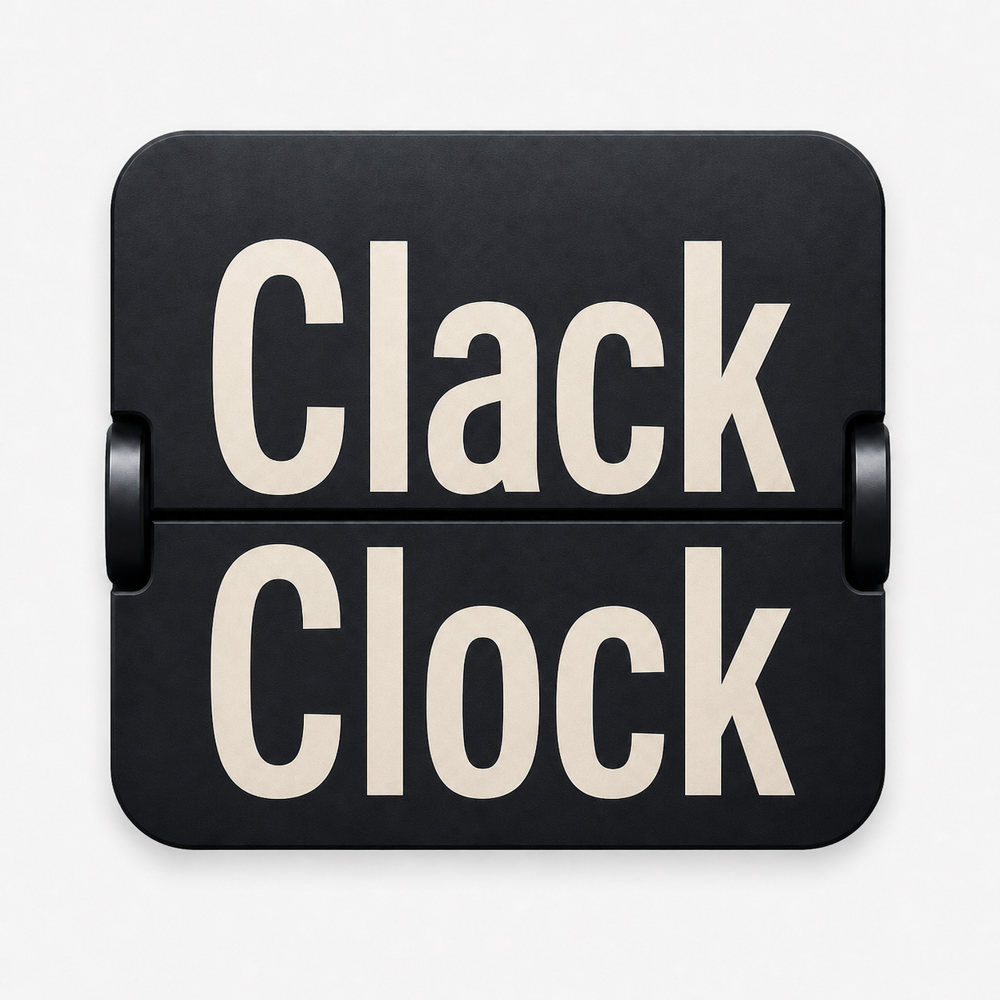
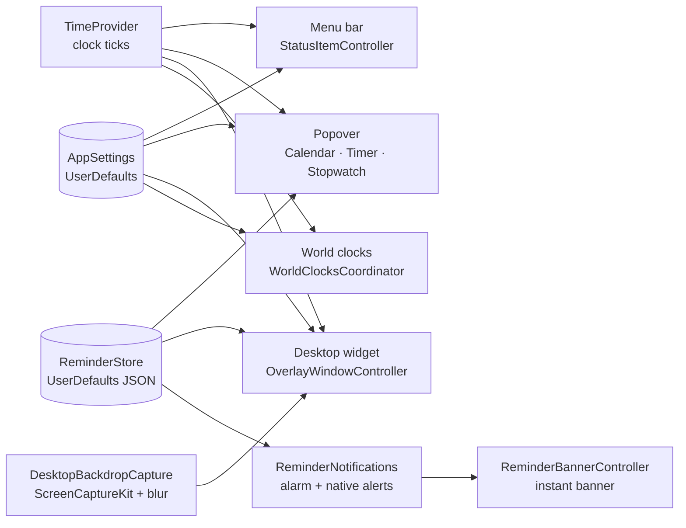

<div align="center">



# FlipClock

**A native split-flap clock for macOS: in the menu bar, in a popover, and on your desktop.**

[](https://www.apple.com/macos/)
[](https://swift.org)
[](#architecture)
[](#requirements)
[](#testing)
[](#license)

</div>

FlipClock is a native macOS app that renders an animated split-flap clock in three places:

- a compact menu bar clock;
- a popover with a calendar, a timer and a stopwatch;
- a desktop widget built to sit beside Apple's own widgets.

Every character (digits, weekday, date, AM/PM) is a real rasterised flip card with a two-leaf flip animation, not styled text. There are no third-party dependencies and no network requests.

---

## Table of Contents

- [Highlights](#highlights)
- [Features](#features)
- [Requirements](#requirements)
- [Installation](#installation)
- [Usage](#usage)
- [Permissions and Privacy](#permissions-and-privacy)
- [Configuration](#configuration)
- [Architecture](#architecture)
- [Development](#development)
- [Testing](#testing)
- [Performance](#performance)
- [Troubleshooting](#troubleshooting)
- [Documentation](#documentation)
- [Contributing](#contributing)
- [License](#license)
- [Third-Party Fonts](#third-party-fonts)

---

## Highlights

- **Real flip cards.** Each glyph is rendered to a bitmap and flipped by Core Animation, the same way on every surface and at every scale.
- **Widget glass that matches the native widgets.**
  - It blurs a capture of your wallpaper instead of relying on `NSVisualEffectView` alone.
  - It follows macOS's *Dim widgets on desktop* setting, in step with the widgets beside it.
- **Reminders that ring on time.** FlipClock shows its own notification-style banner the second a reminder is due, and loops your chosen alert sound until you act on it.
- **World clocks.** Up to five other time zones, each as a menu bar item, a desktop widget, or both.
- **Built for macOS.** Agent app (no Dock icon), Liquid Glass controls on macOS 26, full Reduce Motion, Reduce Transparency and VoiceOver support.

## Features

### Menu bar clock

- Live split-flap clock in the menu bar, always at full brightness.
- Left-click opens the popover. Right-click opens Settings, More (About, Support & Feedback, Tips, FAQ, Website, Share App, More Apps by Me) and Quit.

### Popover

| Tab | What it does |
|---|---|
| **Calendar** | Month grid with reminder badges. Click the heading to browse months, then years. Select a day to add a reminder; the "Due Today" banner lists today's reminders with an acknowledge checkmark. |
| **Timer** | Countdown set with hour, minute and second wheels. Shows a flip-card readout while running and a "Time's up" state when done. It counts against an absolute end time, so it can't drift. |
| **Stopwatch** | Count-up stopwatch with start, stop and reset. It keeps exact elapsed time while the popover is closed. |

### Desktop widget

- Styled to match native macOS desktop widgets. Drag it anywhere; it remembers its position.
- **Sizes:** Half, Default, 2× and 3×.
- **Fill screen:** the clock grows to cover the space between the menu bar and the Dock.
- **Float across screen:** the widget drifts slowly around the desktop.
- **Optional date row**, plus up to two reminder rows ("Today @ 3:00 PM – Stand up") with a count of any more.
- **Glass:**
  - It captures only the wallpaper, never the app windows in front of it, through ScreenCaptureKit.
  - It applies its own tunable Gaussian blur, matched to the native widgets on diffusion, tone and saturation.
  - Without Screen Recording permission it falls back to live vibrancy; with Reduce Transparency on, to an opaque fill.
- **Dimming:** under the *Automatic* setting the widget dims while an app is in front and returns to full colour when you click the wallpaper, like the widgets beside it.
- Right-click the widget for **Settings…** and **Hide Widget**.

### World clocks

- Up to 5 additional time zones.
- Each can have an optional name and can show in the menu bar (for example `TOKYO 07:22 PM`), as its own desktop widget, or both.
- Each widget has its own size and 12/24-hour format.

### Reminders

- **Add:** select a calendar day and choose **Add Reminder** (⌘N), or double-click the day. Each reminder has an exact time.
- **Badges:** days are marked orange when a reminder is within 24 hours and red when it's due today.
- **When a reminder is due:**
  - FlipClock shows its own banner at the top right instantly, and loops your chosen sound.
  - **Dismiss** stops the sound and deletes the reminder.
  - Clicking the banner body only silences the sound.
- **If FlipClock isn't running,** the native macOS notification still fires.
- **After sleep,** reminders that came due while the Mac slept ring on wake. Reminders that were already overdue at launch are never replayed.

> [!NOTE]
> macOS can hold its own notifications back by several seconds while it runs Apple Intelligence processing on them. That's why FlipClock shows its own banner instead, and withdraws the native notification 5 seconds before the reminder is due so you never see it twice.

### Customisation

| Setting | Options |
|---|---|
| Theme | Light, Dark, System |
| Time format | 12-hour, 24-hour |
| AM/PM style | Text or a sun/moon icon |
| Digit font | System plus 37 bundled decorative fonts |
| Widget style | Full Color, Monochrome |
| Card colour | Default, Graphite, Red, Orange, Yellow, Green, Blue, Purple, Pink |
| Frosted glass | Translucent smoked-glass cards that keep a hint of the chosen colour |
| Reminder sound | Your system alert sound, or any built-in macOS alert sound (with preview) |
| Launch at login | On or off |

## Requirements

| Requirement | Version |
|---|---|
| macOS | 14.0 (Sonoma) or later. Liquid Glass controls need macOS 26. |
| Xcode | 16 or later |
| Swift | 5 |
| [XcodeGen](https://github.com/yonaskolb/XcodeGen) | Only needed to regenerate the Xcode project (`brew install xcodegen`) |

There are no package dependencies.

## Installation

FlipClock is distributed as source. Build it with Xcode.

### 1. Clone

```bash
git clone https://github.com/1mrajeevranjan/FlipClock.git
cd FlipClock
```

### 2. Set your signing team

`project.yml` pins the author's team. Replace it with your own, then regenerate the project:

```yaml
CODE_SIGN_STYLE: Manual
CODE_SIGN_IDENTITY: "Apple Development"
DEVELOPMENT_TEAM: YOUR_TEAM_ID   # find it with: security find-identity -v -p codesigning
```

```bash
xcodegen generate
```

> [!IMPORTANT]
> Use a real signing identity, not ad-hoc signing.
> - **Why:** ad-hoc signing puts the binary's own hash into the app's designated requirement. Every rebuild then looks like a new app to macOS, which discards the Screen Recording permission and asks again on every build.
> - **Tests too:** the test bundle must be signed by the same team, because macOS refuses to load a bundle whose Team ID differs from the host app's.

### 3. Build and install

You can build in Xcode (open `FlipClock.xcodeproj` and run the `FlipClock` scheme with ⌘R) or from the command line:

```bash
xcodebuild -project FlipClock.xcodeproj -scheme FlipClock -configuration Release build
```

Copy the built app into `~/Applications` (or `/Applications`) and open it from there:

```bash
cp -R ~/Library/Developer/Xcode/DerivedData/FlipClock-*/Build/Products/Release/FlipClock.app ~/Applications/
open ~/Applications/FlipClock.app
```

> [!TIP]
> Run FlipClock from a stable location. macOS won't register notifications for an app launched from a temporary build folder.

FlipClock is an agent app: it has no Dock icon and no main window. Look for the clock in the menu bar.

## Usage

### Interactions

| Action | Result |
|---|---|
| Left-click the menu bar clock | Open the popover |
| Right-click the menu bar clock | Settings, More, Quit |
| Select a calendar day, then **Add Reminder** | Add a reminder for that day (double-clicking the day also works) |
| Click the calendar's month/year heading | Browse months; click again to browse years |
| Drag the desktop widget | Move it |
| Right-click the desktop widget | Settings…, Hide Widget |
| Click a reminder banner's body | Silence the sound and keep the reminder |
| Click **Dismiss** on a reminder banner | Silence the sound and delete the reminder |

### Keyboard shortcuts

| Where | Shortcut | Action |
|---|---|---|
| Popover | ⌘1 / ⌘2 / ⌘3 | Calendar / Timer / Stopwatch |
| Calendar | ⌘N | Add a reminder for the selected day |
| Calendar | ⌘← / ⌘→ | Previous / next month, year, or page of years |
| Timer | Return | Start |
| Timer and Stopwatch | Space | Pause / resume (start / stop) |
| Timer and Stopwatch | ⌘R | Reset |
| Settings | ⌘1 – ⌘4 | General / Appearance / Desktop Clock / World Clocks |

### Settings

Open Settings by right-clicking the menu bar clock, or from the widget's context menu. The window has sidebar navigation and a live clock preview.

| Tab | Controls |
|---|---|
| General | Desktop clock on/off, launch at login, reminder notification access, reminder sound |
| Appearance | Theme, AM/PM style, digit font |
| Desktop Clock | Size, time format, Full Color / Monochrome, card colour, frosted glass, date row, float across screen, fill screen |
| World Clocks | Up to 5 clocks: time zone, optional name, where to show it, widget size, 12/24-hour |

## Permissions and Privacy

| Permission | Used for | If declined |
|---|---|---|
| **Notifications** | Native reminder alerts when FlipClock isn't running | FlipClock's own banner and sound still work while it runs |
| **Screen Recording** | Sampling the wallpaper behind the desktop widget to blur it | The widget falls back to the system's softer vibrancy |

- **Notifications:** enable them in Settings › General, or accept the prompt when you add your first reminder. Set **Alert Style** to **Persistent** in System Settings › Notifications › FlipClock so native reminders stay on screen until dismissed. **Open Settings…** in FlipClock jumps there.
- **Privacy:** FlipClock makes no network requests and collects no data.
  - The captured wallpaper frame is blurred in memory and never written to disk or sent anywhere.
  - Preferences and reminders are stored locally in `UserDefaults`.

## Configuration

All state lives in the `com.rajeevranjan.flipclock` defaults domain.

| Key | Contents |
|---|---|
| `reminders` | JSON array of reminders |
| `NSWindow Frame DesktopOverlayFrame` | Saved desktop widget position |
| Other keys | One per setting (theme, size, font, card colour and so on) |

Useful resets (quit FlipClock first):

```bash
# Move the desktop widget back to its default top-right position
defaults delete com.rajeevranjan.flipclock "NSWindow Frame DesktopOverlayFrame"

# Reset every setting and delete all reminders
defaults delete com.rajeevranjan.flipclock
```

> [!WARNING]
> The second command permanently deletes all reminders.

## Architecture

FlipClock pairs SwiftUI content views with AppKit for everything that needs window-level control: status items, window levels, collection behaviour and login items.



| Component | Responsibility |
|---|---|
| `TimeProvider` | Publishes the clock ticks every surface reads. |
| `SplitFlapClockFace` | The animated face, shared by every surface at different scales. |
| `DigitFaceRenderer` / `FlipCardLayer` | Rasterise each glyph and drive the Core Animation flip. The static halves are masked in step with the flap so translucent cards never show a ghost. |
| `StatusItemController` | Menu bar clock, popover and context menu. |
| `OverlayWindowController` | Desktop widget window: level, size, position, fill screen and drift. |
| `WidgetGlassBackground` + `DesktopBackdropCapture` | The widget's glass, from a pre-blurred wallpaper capture. |
| `ReminderNotifications` | Looping alarm, wake catch-up, and native notifications for when the app isn't running. |
| `ReminderBannerController` | The non-activating, notification-style banner shown the instant a reminder is due. |
| `AppSettings` / `ReminderStore` | The single source of truth for preferences and reminders, published with Combine. Both take an injectable `UserDefaults`. |

### Project structure

```text
FlipClock/
├── App/             Entry point and AppKit bridge (AppDelegate, FlipClockApp, world clocks)
├── CountdownTimer/  Timer, stopwatch, wheel picker, flip time display
├── DesktopOverlay/  Widget windows, glass background, wallpaper capture, focus/dim tracking
├── FlipClock/       Split-flap rendering: clock face, digits, flip layer, colours, fonts
├── MenuBar/         Menu bar clock views and status item controllers
├── Popover/         Popover, calendar, vibrant hosting controller
├── Reminders/       Model, store, add form, badges, Due Today list, alarm, banner
├── Settings/        AppSettings, settings window and views, world clock model
└── TimeEngine/      Tick generation and time/digit maths
FlipClockTests/      Unit, UI-control, stress and performance tests
Fonts/               Bundled digit fonts (each with its own licence)
project.yml          XcodeGen project definition (the source of truth for the Xcode project)
script/              Build-and-run helper
```

See [`architecture.md`](architecture.md) for the module-by-module map.

## Development

### Command-line build

```bash
xcodebuild -project FlipClock.xcodeproj -scheme FlipClock -configuration Debug build
```

Trust `xcodebuild`'s `BUILD SUCCEEDED` / `BUILD FAILED` result over editor diagnostics. SourceKit in this project often shows stale errors that don't reflect the real build.

### Build-and-run helper

```bash
./script/build_and_run.sh              # build, then relaunch FlipClock
./script/build_and_run.sh --verify     # build, launch, and check the process is running
./script/build_and_run.sh --logs       # build, launch, and stream the app's logs
./script/build_and_run.sh --telemetry  # build, launch, and stream the app's subsystem logs
./script/build_and_run.sh --debug      # build and launch under LLDB
```

### Adding, removing or renaming files

`project.yml` defines the sources; the generated `FlipClock.xcodeproj` is committed. Regenerate it rather than editing `project.pbxproj` by hand:

```bash
xcodegen generate
```

### Debug logging

`print()` from a GUI app launched with `open` isn't captured. Use `NSLog()` and read it with the full path to `log`, because `log` on its own is a zsh builtin:

```bash
/usr/bin/log show --last 5m --predicate 'process == "FlipClock"' --style compact
```

### Conventions

- `AppSettings` is the only settings store; don't add a second one.
- AppKit owns windows, levels, status items and login items; SwiftUI owns content.
- Comments explain *why*, never *what*. Match the density of the doc comments in `DesktopOverlay/`.
- Commit messages follow `<type>: <description>` (`feat`, `fix`, `refactor`, `docs`, `test`, `chore`, `perf`, `ci`).

## Testing

```bash
xcodebuild test -project FlipClock.xcodeproj -scheme FlipClock -destination 'platform=macOS'
```

The suite has 133 XCTest cases:

| Area | Coverage |
|---|---|
| Time engine | Tick generation, digit deltas, alignment to the wall clock |
| Settings | Persistence, defaults, fallbacks, migration |
| Reminders | Store, native requests, hand-over window, alarm ringing and dismissal, sounds |
| UI controls | Every popover, Settings and reminder-banner control pressed through the accessibility tree (`UIControlsTests`) |
| Rendering | Glyph rasterisation, timer-wheel numerals, timer lens in both themes, image-cache reuse |
| Timer / stopwatch | Accuracy while hidden, popover reopening |
| Stress | 1,000 mixed tool/control cycles, 9,600 calendar page moves, 300 settings and world-clock cycles, 500 reminders, 1,000 key events (`InteractionStressTests`) |
| Performance | `measure` blocks over per-tick maths, capture gating and persistence |

To run the suite repeatedly, each time in a fresh process:

```bash
xcodebuild test -project FlipClock.xcodeproj -scheme FlipClock -destination 'platform=macOS' \
  -test-iterations 3 -test-repetition-relaunch-enabled YES -parallel-testing-enabled NO
```

Tests always use a throwaway `UserDefaults(suiteName:)`, never the real preferences.

Some things still need checking by hand: live click-through, native permission dialogs, audible playback and desktop gestures. See [`QA.md`](QA.md).

> [!NOTE]
> **Known issue:** two assertions in `UIControlsTests.testCalendarPagesMonthsAndDrillsThroughMonthsAndYears` currently fail. They fail on `main` too, independently of recent changes.

## Performance

FlipClock is meant to stay running all day, so idle cost matters.

- **Hidden widgets don't render.** A widget fully covered by app windows freezes its clock until it's uncovered.
- **Timers only run when visible.**
  - The stopwatch updates every 30 ms only while its tab is visible.
  - A hidden countdown uses a single completion alarm instead of ticking every second.
- **Glyph bitmaps** share an `NSCache` that targets 64 MiB and 2,048 entries, so macOS can reclaim them.
- **Wallpaper capture.** Matching capture requests share one capture-and-blur task. Both looks (vivid and dimmed) are pre-blurred, so switching between them is a crossfade with no live blur.
- **No idle timers when hidden.** Timers that only matter while a window is visible are stopped with it, so they don't defeat App Nap.

Development spot check (Debug build, popover closed): about 0.4% CPU on average.

## Troubleshooting

<details>
<summary><b>The desktop widget isn't visible</b></summary>

- The widget sits below normal app windows by design, like the native widgets. Show the desktop to see it.
- Check that **Desktop clock** is on in Settings › General.
- If it ended up off screen, quit FlipClock and reset its position:
  `defaults delete com.rajeevranjan.flipclock "NSWindow Frame DesktopOverlayFrame"`.
</details>

<details>
<summary><b>Reminder notifications arrive late or not at all</b></summary>

- While FlipClock runs, reminders use its own banner, which isn't affected by delays in macOS.
- Native notifications only fire when FlipClock isn't running. If they arrive late, look in Console for `IntelligenceActor ... exceeded 10.0 seconds` from `usernoted`. That's a macOS-side stall; a restart usually clears it.
- Run FlipClock from `~/Applications`, not a build folder, or macOS won't register its notifications.
</details>

<details>
<summary><b>macOS asks for Screen Recording after every build</b></summary>

The app is ad-hoc signed. Set a real `DEVELOPMENT_TEAM` in `project.yml` and run `xcodegen generate` (see [Installation](#2-set-your-signing-team)).
</details>

<details>
<summary><b>The widget glass looks flat or grey</b></summary>

- Grant Screen Recording in System Settings › Privacy & Security; without it the widget uses plain vibrancy.
- With Reduce Transparency on, the widget is deliberately opaque.
</details>

<details>
<summary><b>The menu bar clock is missing</b></summary>

On Macs with a notch, or with a menu bar manager installed, the status item can be hidden when the menu bar is full. Remove a few menu bar items, or reveal the hidden ones in your menu bar manager.
</details>

## Documentation

| File | Contents |
|---|---|
| [`architecture.md`](architecture.md) | Module-by-module map |
| [`design.md`](design.md) | Visual design system: glass tuning, typography, colour tokens, reminder visuals |
| [`memory.md`](memory.md) | Lessons learned and the reasoning behind non-obvious workarounds |
| [`phases.md`](phases.md) | Development milestones |
| [`rules.md`](rules.md) | Enforceable project rules |
| [`QA.md`](QA.md) | Manual QA results and remaining checks |
| [`CLAUDE.md`](CLAUDE.md) | Context and known gotchas for AI coding assistants |

Read `design.md`, `memory.md` and the *Known Gotchas* in `CLAUDE.md` before changing anything to do with glass, animation, windows or notifications. Several behaviours that look like style choices are workarounds for specific AppKit, Core Animation and Core Image quirks.

## Contributing

Issues and pull requests are welcome: [open an issue](https://github.com/1mrajeevranjan/FlipClock/issues).

1. Fork the repository and create a branch from `main`.
2. Make your change. Add new files through `project.yml` and run `xcodegen generate`.
3. Make sure that:
   - `xcodebuild ... build` succeeds;
   - `xcodebuild test ...` introduces no new failures;
   - new behaviour has tests, using a throwaway `UserDefaults(suiteName:)`;
   - comments explain *why*, matching the existing style.
4. Write commit messages as `<type>: <description>`.
5. Open a pull request describing the change and how you verified it.

## License

No license has been chosen yet. Until a `LICENSE` file is added, all rights are reserved by the author. Being publicly visible doesn't grant anyone the right to use, modify or distribute the code.

## Third-Party Fonts

The decorative digit fonts in [`Fonts/`](Fonts) are third-party works and keep their own licences. Each font's folder includes its licence or readme where the author provided one.

> [!CAUTION]
> These fonts are free for **personal or non-commercial use only**: Abduction 2002, Bring Me a Helicopter, KG Primary Italics, Linear Beam, Space Age and Sportfield Varsity. Several other fonts ship without any licence file, so their terms are unknown. Check every font's licence before distributing FlipClock commercially, and remove any whose terms don't allow it.

The menu bar, popover and widget fall back to the system font when no decorative font is selected.
